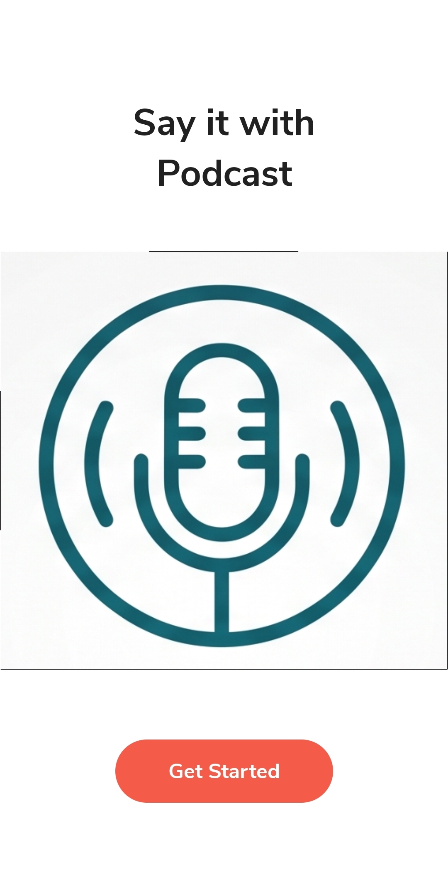

# Podcast Prime 🎧

**An Android app for discovering and listening to podcasts built with Jetpack Compose & Exoplayer.**

A Podcast discovery and audio playback together in an Android experience written in Kotlin. It integrates the Listen Notes API to retrieve podcast information and uses ExoPlayer to deliver a feature-rich listening experience, including background playback and offline caching.

Podcast metadata is powered by the [Listen Notes API](https://www.listennotes.com/).

## What the App Offers

- **Modern Android UI:** Declarative interfaces built with Jetpack Compose, featuring custom animations, screen transitions, responsive layouts, and light and dark themes.
- **Seamless Navigation:** Compose Navigation provides a structured flow between the app's screens.
- **Podcast Discovery:** Fetches podcast metadata from the Listen Notes API.
- **Continuous Listening:** Supports audio playback in the background through a foreground service.
- **System Media Controls:** Displays media-style notifications for convenient playback management.
- **Media Session Integration:** Exposes playback information and controls through `MediaBrowserService` and the active media session.
- **Flexible Playback:** Includes play, pause, next, previous, shuffle, repeat, and stop actions.
- **Offline Caching:** Uses ExoPlayer's `CacheDataSource` to cache media and support playback of cached content.
- **Dynamic Artwork Colors:** Extracts color palettes from podcast images with the Android Palette API to complement the interface.

## Technical Stack

The project uses the following Android libraries and components:

| Technology | Purpose |
|---|---|
| Jetpack Compose | UI development |
| ExoPlayer | Audio playback and media caching |
| Glide | Image loading |
| Hilt | Dependency injection |
| Retrofit | API communication |
| Navigation | Screen navigation |
| ViewModel | UI state and lifecycle-aware logic |
| DataStore | Persistent data storage |
| Palette API | Color extraction from images |

The application follows the **MVVM (Model–View–ViewModel)** architectural pattern, with Hilt managing dependency injection.

## Screenshots

| Welcome                                                  | Home                                                        | Podcast Details                                                    | Audio Player                                                    |
|----------------------------------------------------------|-------------------------------------------------------------|--------------------------------------------------------------------|-----------------------------------------------------------------|
|  |  |  |  |

